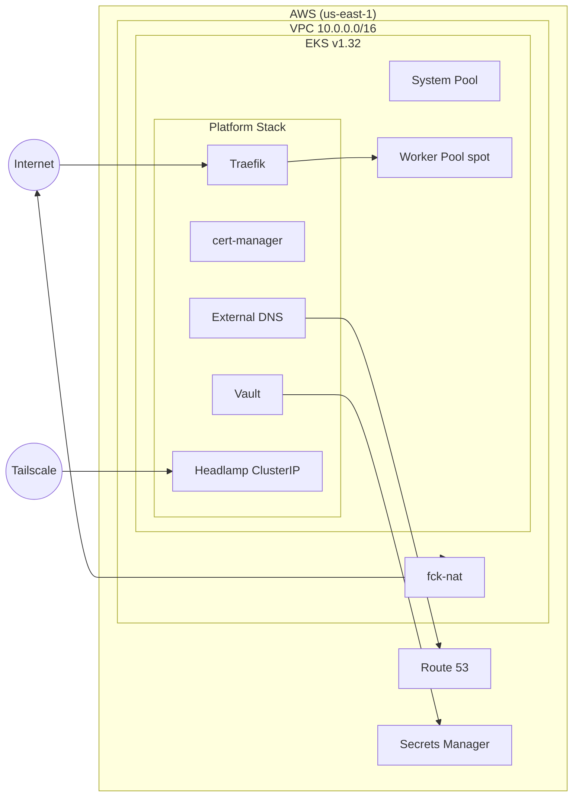

# Single-Cloud AWS Example

Deploys a full production stack on AWS using the nimbus factory API.

## Components

- **Network** — VPC with public/private subnets and fck-nat (~$3/mo)
- **Cluster** — EKS with Auto Mode, system + spot worker pools
- **DNS** — Route 53 hosted zone with A and CNAME records
- **Secrets** — AWS Secrets Manager for database credentials
- **Platform** — Traefik, cert-manager, External DNS, Argo CD, Vault, and Headlamp

## Architecture



## Usage

```bash
pulumi new typescript
npm install @reyemtech/nimbus @pulumi/aws @pulumi/kubernetes
cp index.ts your-project/index.ts
pulumi up
```

Headlamp installs as a private `ClusterIP` service and is included in
`platform.exposedServices`. The example only creates the Tailscale access
gateway when `enableTailscaleAccess` is true. Set the `tailscaleOAuthClientId`
and secret `tailscaleOAuthClientSecret` Pulumi config values to enable it.
Headlamp uses its managed pod ServiceAccount by default, bound to a Nimbus
ClusterRole that reads all API resources, including Secrets, custom resources,
Gateway API types, DeviceClasses, and LeaderWorkerSets.
Users do not need to create or paste a token, and all viewers share that identity.
Keep the endpoint behind the access-controlled Tailscale gateway. Set
`headlamp.authentication` to `"user-token"` to require individual Kubernetes
tokens instead. EKS CPU and memory usage also requires the opt-in `metricsServer`
add-on in the cluster's AWS provider options.

For local access without Tailscale:

```bash
kubectl port-forward -n headlamp svc/headlamp 8080:80
```
